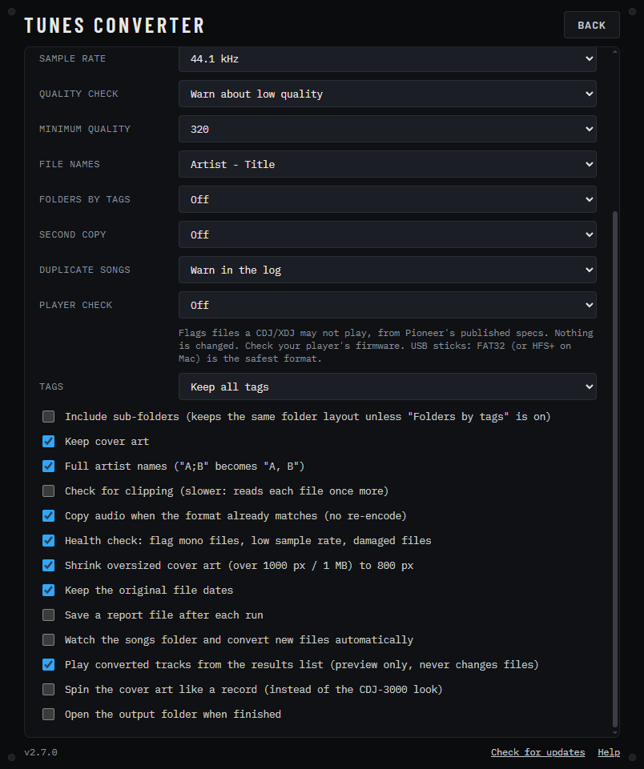

<div align="center">

# 🎵 Tunes Converter

**Drop a folder of music in, press START, get tidy files out.**
MP3 · AAC · FLAC · WAV · AIFF · Opus — with correct names, tags and an optional fake-quality check.

[](https://github.com/bobojuice/tunes-converter/releases/latest)

[](LICENSE)

**[⬇️ Download the latest release](https://github.com/bobojuice/tunes-converter/releases/latest)** ·
**[📖 Full instructions](docs/HOWTO.md)**

 

</div>

## ✨ What it does

**Convert**
- **Pick your format:** MP3 at 320 kbps by default (via ffmpeg/LAME), or **AAC (M4A), FLAC, WAV, AIFF or Opus**.
  Reads FLAC, WAV, AIFF, M4A, OGG, Opus, WMA and MP3.
- **Made for DJs:** WAV, AIFF and FLAC come out at **16-bit** (the most compatible) or 24-bit. Sources stored as
  **32-bit float** are converted down to the depth you choose, dithered at 16-bit. AIFF keeps tags and cover art,
  which WAV tags often lose, so it suits Rekordbox and CDJs.
- **Copy, don't re-encode:** a file already in the chosen format (MP3, AAC, Opus, FLAC, WAV or AIFF) keeps its audio
  untouched; only the name, tags and cover are fixed. For lossless formats the bit depth must match your setting.
- **Presets:** save your settings under a name (e.g. "DJ USB: AIFF 16-bit"), load them with one click, and
  export or import them as a file to share.
- **Second copy (optional):** write every song in a second format and folder in the same run, for example an AIFF
  library plus an MP3 share folder.

**Names, tags and folders**
- **Correct names:** files become `Artist - Title` by default. Tracks with several artists in separate tags
  (e.g. `ARTIST=Pola & Bryson` + `ARTIST=Cimone`) become `Pola & Bryson, Cimone - Title` instead of keeping only
  the last artist. Pick another pattern or write your own with `{artist}` `{title}` `{album}` `{albumartist}`
  `{track}` `{year}`.
- **Folders by tags (optional):** sort the output into folders such as Artist/Album, Album Artist/Album or Genre
  (or your own pattern). A missing tag becomes "Unknown Artist" and so on.
- **Tag options:** keep all tags, keep only the main fields, or remove everything. Cover art stays unless you turn
  it off; MP3 tags are written as ID3v2.3 (works with DJ software and car stereos). Oversized cover art
  (over 1000 px or about 1 MB) is shrunk to 800 px; normal art is left exactly as it is.
- **Original dates:** converted files keep the original file's modified date.

**Checks (they only flag, nothing is changed)**
- **Fake-quality check (optional):** measures where each file's audio *really* stops, not what its tag claims, and
  estimates its true quality. Warn about or skip files below a minimum you choose, such as a 128k MP3 passed off as
  320 or lossless. It is an estimate, not proof. [How it works](docs/HOWTO.md#quality-check-spot-fake-files).
- **Health check:** flags mono-as-stereo, low sample rate and damaged or truncated files.
- **Clipping check (optional):** flags tracks with possible clipping or peaks above 0 dBFS.
- **Duplicate songs:** the same song in two files or formats is flagged in the log, or the extra copies are skipped.
- **Player check (optional):** pick your CDJ/XDJ model and files it may not play (format, sample rate or bit depth)
  are flagged, from Pioneer's published specs.

**Automation and records**
- **Watch folder (optional):** new music files that appear in the songs folder are converted automatically.
- **Save report (optional):** a CSV report with each file's status, notes, flags and peak after every run.

**The app**
- **Playback preview (optional, on by default):** click a converted track in the list to hear it (a skipped duplicate plays the converted copy it matched). A scrolling waveform, skim bar, live EQ and level meter, pause, volume and a +/-8% tempo fader, plus a CDJ-3000-style platter (still cover art, white rim, sweeping playhead; a spinning-record look is in Settings). It plays a temporary copy decoded by ffmpeg (deleted when you stop or quit); your files are never changed.
- **Built like DJ gear:** a CDJ-style screen with a live waveform while it converts, a round progress platter,
  lit format pads, and a track list with colour flags (red clipping, orange duplicate, pink quality, teal health,
  violet player).
- **Easy to use:** drag and drop a folder or files, include sub-folders (the layout is copied), see the time left.
- **Safe:** the audio is never altered, originals are never touched, output goes to a separate folder, and existing
  files are skipped so reruns are harmless.
- **Private:** nothing is uploaded anywhere; everything runs locally. The optional *Check for updates* button only
  contacts GitHub when you click it.

## 🚀 Install and use

| | Download | Run |
| --- | --- | --- |
| **Windows** | `TunesConverter-<version>-win-x64-setup.exe` (installer) or `...-win-x64.zip` (just unzip and run) | Run the installer (no admin rights; adds a Start menu entry and a Desktop shortcut), or unzip anywhere and double-click `Tunes Converter.exe`. |
| **macOS** | `TunesConverter-<version>-mac-arm64.dmg` (Apple Silicon) or `-mac-x64.dmg` (Intel) | Open the dmg and drag the app to Applications. The first time, open **System Settings > Privacy & Security** and click **Open Anyway**. *Not yet tested on a real Mac.* |
| **Linux** | `TunesConverter-<version>-linux-x86_64.AppImage` (or `.tar.gz`) | Make it executable and run it. If it will not start, see the troubleshooting table. |

Then add **ffmpeg** once (it is not included). The app asks on first launch and tells you what to do:
on Windows press **Download ffmpeg**, on macOS use the **Get Homebrew** / **Copy command** buttons
(`brew install ffmpeg`), on Linux install it with your package manager.

Step-by-step help for each system, the Gatekeeper/AppImage notes and troubleshooting:
**[docs/HOWTO.md](docs/HOWTO.md)**.

## ⚙️ Menu and settings

The main screen has the format pads, the bit-depth/bitrate knob and the option keys. Click **MENU** (top right) for every option, including presets: output format, bit depth, bitrate, sample rate, quality check and
minimum, file names, folders by tags, second copy, duplicate songs, player check, tags, sub-folders, cover art, full artist names, clipping and health checks, copy mode, cover-art shrinking, original dates, saving a report, watching the songs folder, playback preview, and opening the output folder when finished.
The two folders and all options are saved automatically in `settings.json`. See
[docs/HOWTO.md](docs/HOWTO.md#settings) for where it lives and what each value means.

## 🛠️ Build from source

Needs [Node.js](https://nodejs.org) 22 or newer.

```bash
npm ci
npm start          # run the app
npm test           # unit + integration tests (needs ffmpeg and ffprobe on your PATH or in ./bin)
npm run dist       # package for the OS you are on, into ./dist
```

GitHub Actions builds all three systems (`.github/workflows/build.yml`); pushing a tag like `v2.7.0` collects them
into a draft release. The earlier Windows-only PowerShell version (v1.x) is still available under **Releases**.

## 📝 Status

I built this for myself and I'm sharing it in case it's useful to you. It works for me, but I'm not actively
maintaining it, so I can't promise fixes, features, or replies. It's provided as-is, with no warranty
(see the MIT license).

Issues are turned off. You're very welcome to fork it and make it your own. Hope it helps! 💚

## ⚖️ License

MIT (`LICENSE`). The app is built on Electron (MIT, includes Chromium). ffmpeg is a separate program with its own
license (the common builds are GPL) and is not bundled; see `THIRD-PARTY-NOTICES.md`.
