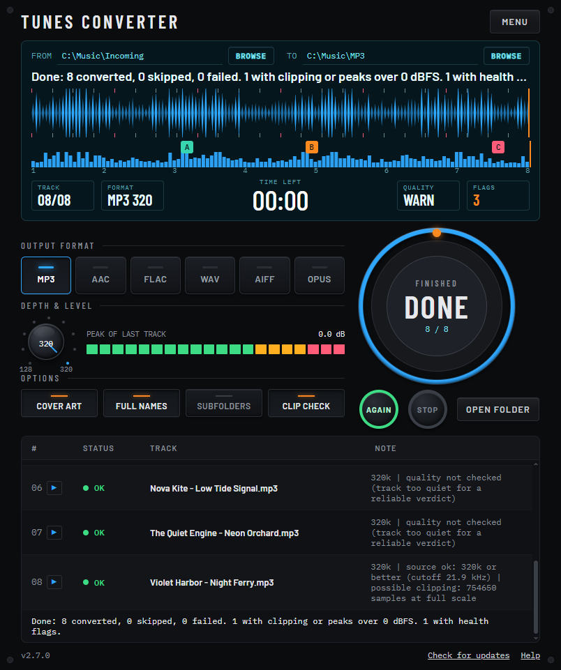

# Tunes Converter

Drop a folder of music in, press **START**, get tidy MP3s out. A small, portable app for **Windows, macOS and Linux**.

**[Download the latest release](https://github.com/bobojuice/tunes-converter/releases/latest)** |
**[Full instructions](docs/HOWTO.md)**



## What it does

- **MP3 at 320 kbps** (CBR, 44.1 kHz) by default, via ffmpeg/LAME. Bitrate and sample rate are one click away.
- **Correct names:** files become `Artist - Title.mp3`. Tracks with several artists in separate tags
  (e.g. `ARTIST=Pola & Bryson` + `ARTIST=Cimone`) become `Pola & Bryson, Cimone - Title.mp3` instead of
  keeping only the last artist.
- **Fake-quality check (optional):** measures where each file's audio really stops, not what its tag claims, to
  estimate its likely real quality. It can warn about or skip files below a minimum you choose, for example a
  128k MP3 passed off as 320 or lossless. It is an estimate, not proof. Details in
  [docs/HOWTO.md](docs/HOWTO.md#quality-check-spot-fake-files).
- **Tags and cover art kept**, written as ID3v2.3 (works with DJ software and car stereos).
- **Originals are never touched.** Output goes to a separate folder; existing files are skipped, so reruns are safe.
- Reads FLAC, WAV, AIFF, M4A, OGG, Opus, WMA and MP3. MP3 sources are copied as they are (no re-encoding,
  tags still fixed).
- Nothing is uploaded anywhere. Everything runs locally.

## Install and use

| System | Download | Run |
| ------ | -------- | --- |
| **Windows** | `TunesConverter-<version>-win-x64.zip` | Unzip anywhere (a USB stick is fine) and double-click `Tunes Converter.exe`. |
| **macOS** | `TunesConverter-<version>-mac-arm64.dmg` (Apple Silicon) or `-mac-x64.dmg` (Intel) | Open the dmg, drag the app anywhere, right-click it and choose **Open** the first time. |
| **Linux** | `TunesConverter-<version>-linux-x86_64.AppImage` (or `.tar.gz`) | Make it executable and run it. |

Then add **ffmpeg** once (it is not included): on Windows press **Download ffmpeg** in the app, on macOS run
`brew install ffmpeg`, on Linux install it with your package manager. The app tells you what to do if it can't
find it.

Step-by-step help for each system, the Gatekeeper/AppImage notes and troubleshooting:
**[docs/HOWTO.md](docs/HOWTO.md)**.

## Settings

The two folders and the option chips (bitrate, sample rate, quality check, minimum) are saved automatically in
`settings.json`. See [docs/HOWTO.md](docs/HOWTO.md#settings) for where it lives and what each value means.

## Build from source

Needs [Node.js](https://nodejs.org) 22 or newer.

```bash
npm ci
npm start          # run the app
npm test           # unit + integration tests (needs ffmpeg and ffprobe on your PATH or in ./bin)
npm run dist       # package for the OS you are on, into ./dist
```

GitHub Actions builds all three systems (`.github/workflows/build.yml`); pushing a tag like `v2.0.0` collects them
into a draft release.

The earlier Windows-only PowerShell version (v1.x) is still available under **Releases**.

## Status

I built this for myself and I'm sharing it in case it's useful to you. It works for me, but I'm not actively
maintaining it, so I can't promise fixes, features, or replies. It's provided as-is, with no warranty
(see the MIT license).

Issues are turned off. You're very welcome to fork it and make it your own. Hope it helps!

## License

MIT (`LICENSE`). The app is built on Electron (MIT, includes Chromium). ffmpeg is a separate program with its own
license (the common builds are GPL) and is not bundled; see `THIRD-PARTY-NOTICES.md`.
